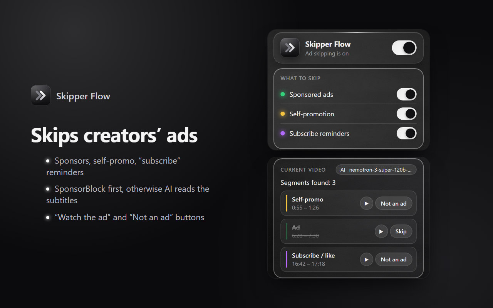
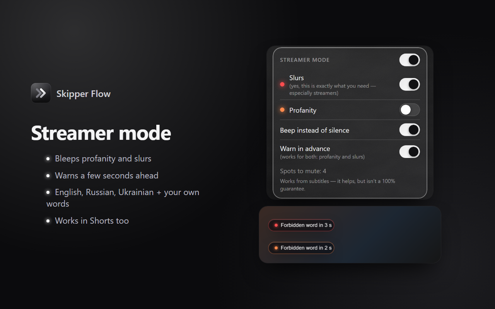
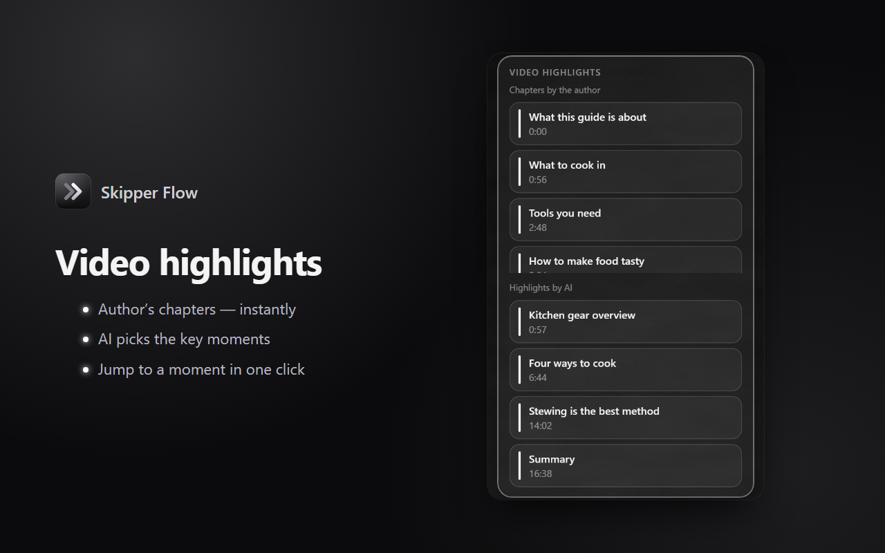

# Skipper Flow

**English** · [Русский](README.ru.md)

**A Chrome extension that makes watching YouTube cleaner:** it skips creators' sponsor segments, bleeps profanity and slurs for streamers, and finds the highlights of a video. Where no ready-made markup exists, an AI finds the ads by reading the subtitles.



## Features

### ⏭ Skipping creators' ads
- Skips sponsored segments, self-promotion (merch, Patreon, courses) and "subscribe" reminders.
- First it checks the open [SponsorBlock](https://sponsor.ajay.app/) database. If there's nothing there, an AI finds the segments from the video's subtitles. This covers Russian-speaking and smaller channels that SponsorBlock rarely marks up.
- Colored marks on the video timeline, plus a notification with "Watch the ad" and "Not an ad" buttons (feedback goes to the server).

### 🎙 Streamer mode
- Bleeps or mutes slurs and profanity — for example, when a streamer reacts to other people's videos live.
- Warns a few seconds before a forbidden word.
- Dictionaries for English, Russian and Ukrainian, prefix-aware matching for Slavic profanity, plus your own words.
- Works in YouTube Shorts too. Audio is muted right in the tab, so OBS captures the already-muted sound.



### 📌 Video highlights
- The author's chapters — instantly, no AI needed.
- A "Find highlights" button: the AI picks 3–6 key moments you can jump to in one click.



The interface is available in English and Russian (chosen automatically by the browser language).

## How it works

```
YouTube player ──subtitles request──▶ interceptor.js (page world)
                                          │ postMessage
                                          ▼
                                     content.js ──▶ ad skipping, streamer mode, timeline marks
                                          │ chrome.runtime.sendMessage
                                          ▼
                                    background.js (service worker)
                          ┌───────────────┼────────────────────────┐
                          ▼               ▼                        ▼
                     SponsorBlock   Skipper Flow server       OpenRouter
                                    (Cloudflare Workers)      (with your own key)
                                          │
                                          ▼
                                   OpenRouter (AI) + D1 cache
```

Interesting bits of the code:
- **Intercepting subtitles.** YouTube won't serve subtitles from a direct URL (it needs a player token), so a script in the page world wraps `XMLHttpRequest` / `fetch` and "listens in" on the response the player itself receives ([interceptor.js](extension/content/interceptor.js)).
- **Video chapters** come from the data YouTube fetches when you switch videos (the `/youtubei/v1/get_watch` request) rather than from the page — so you never see the previous video's chapters.
- **Muting words** goes through Web Audio (`GainNode`) instead of `video.muted`, so the YouTube player can't "undo" the mute while seeking ([streamer.js](extension/content/streamer.js)).
- **AI with a fallback model:** models are tried in order on an error, timeout or invalid JSON; the answer is validated with zod; a `max_tokens` limit cuts off a reasoning model that gets stuck in a loop ([ai.js](backend/src/ai.js)).
- **A server with no downtime and no cost:** Cloudflare Workers + D1, results cached for all users, per-IP rate limits and a daily cap on AI calls ([index.js](backend/src/index.js)).

## Tech stack

| Part | What's used |
|---|---|
| Extension | Chrome Manifest V3, plain JavaScript with no build step, content scripts (MAIN and isolated world), service worker, `chrome.storage`, `chrome.i18n`, Web Audio API |
| Server | Cloudflare Workers, D1 (SQLite), zod, wrangler |
| AI | [OpenRouter](https://openrouter.ai/): NVIDIA Nemotron 3 Super (free) + its paid version as a fallback, structured outputs |
| Data | SponsorBlock API (queried by a SHA-256 hash prefix of the video ID) |

## Project structure

```
extension/   — the Chrome extension (_locales/ holds the English and Russian texts)
backend/     — the server on Cloudflare Workers + D1 database
store/       — Chrome Web Store texts and images (en / ru)
docs/        — GitHub Pages site (privacy policy)
```

## Running it yourself

**Extension:** `chrome://extensions` → turn on "Developer mode" → "Load unpacked" → pick the `extension` folder. By default it works with the published server. You can set your own [OpenRouter](https://openrouter.ai/keys) key on the settings page — then AI requests go straight to OpenRouter, without our server.

**Local server** (needs Node.js 20+):

```bash
cd backend
npm install
cp .dev.vars.example .dev.vars   # put your OPENROUTER_API_KEY in it
npm run db:init:local
npm run dev                      # http://localhost:8787
```

To make the extension talk to the local server, temporarily add `"http://localhost/*"` to `host_permissions` in `extension/manifest.json` and set `http://localhost:8787` on the extension's settings page.

**Your own server on Cloudflare:** `npm run login` → `npm run db:create` (put the `database_id` into `wrangler.jsonc`) → `npm run db:init` → `npm run secret:key` → `npm run deploy`.

**Chrome Web Store package:** `powershell -ExecutionPolicy Bypass -File pack-extension.ps1` → `dist/skipper-flow-<version>.zip`.

> On Windows PowerShell, type `npm.cmd` instead of `npm`.

## Privacy

Only the video ID and its subtitle text are sent to the server — for the AI analysis. Streamer mode and chapters work entirely in the browser. Details are in the [privacy policy](https://bellka555.github.io/skipper-flow/privacy.html).

## Credits

Ad segment data is partly provided by [SponsorBlock](https://sponsor.ajay.app/) under the [CC BY-NC-SA 4.0](https://creativecommons.org/licenses/by-nc-sa/4.0/) license.
