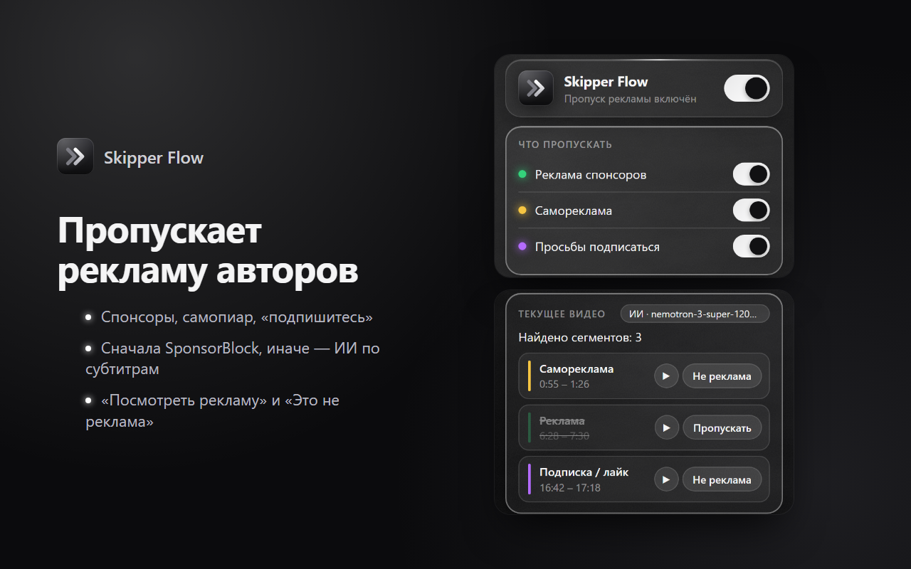
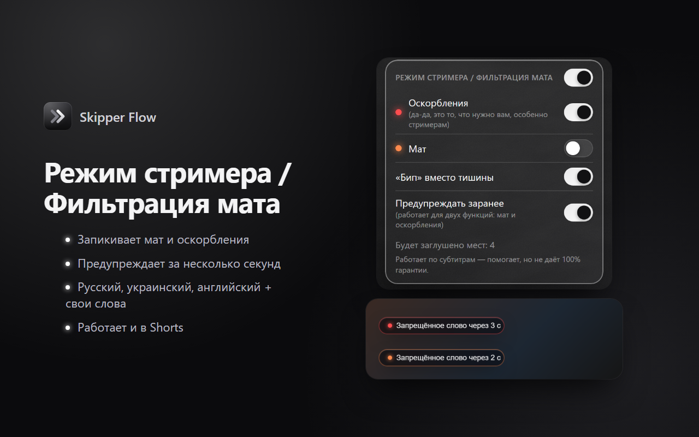
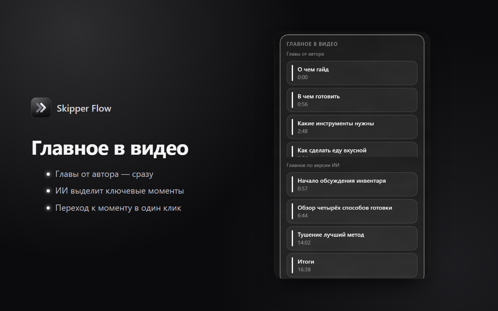

# Skipper Flow

[English](README.md) · **Русский**

**Расширение для Chrome, которое делает просмотр YouTube чище:** пропускает рекламные вставки авторов, запикивает мат и оскорбления для стримеров и показывает главное в видео. Там, где нет готовой разметки, рекламу находит ИИ по субтитрам.

**[⬇ Установить из Chrome Web Store](https://chromewebstore.google.com/detail/bpbfccelbghmcigkhbpjeaeppkkmahek)**



## Возможности

### ⏭ Пропуск рекламы авторов
- Перематывает спонсорскую рекламу, самопиар (мерч, Boosty, курсы) и просьбы подписаться.
- Сначала берёт разметку из открытой базы [SponsorBlock](https://sponsor.ajay.app/). Если её нет — фрагменты находит ИИ по субтитрам видео. Это закрывает русскоязычные и небольшие каналы, которые SponsorBlock размечает редко.
- Цветные метки на шкале видео, уведомление с кнопками «Посмотреть рекламу» и «Это не реклама» (отзыв уходит на сервер).

### 🎙 Режим стримера / Фильтрация мата
- Запикивает или глушит оскорбления и мат — например, когда стример реагирует на чужие видео в эфире.
- Предупреждает за несколько секунд до запрещённого слова.
- Словари на русском, украинском и английском, учёт приставок (`а-хуительно`, `за-ебал`) и свои слова.
- Работает и в YouTube Shorts. Звук глушится прямо во вкладке, поэтому OBS захватывает уже заглушённый звук.



### 📌 Главное в видео
- Главы от автора — сразу, без ИИ.
- Кнопка «Найти главное»: ИИ выделяет 3–6 ключевых моментов, к ним можно перейти в один клик.



Интерфейс на английском, русском и украинском (выбирается автоматически по языку браузера).

## Как это устроено

```
YouTube-плеер ──запрос субтитров──▶ interceptor.js (мир страницы)
                                        │ postMessage
                                        ▼
                                   content.js ──▶ пропуск рекламы, режим стримера, метки на шкале
                                        │ chrome.runtime.sendMessage
                                        ▼
                                  background.js (service worker)
                         ┌──────────────┼───────────────────────┐
                         ▼              ▼                       ▼
                    SponsorBlock   сервер Skipper Flow     OpenRouter
                                   (Cloudflare Workers)    (со своим ключом)
                                        │
                                        ▼
                                  OpenRouter (ИИ) + кэш в D1
```

Интересные места в коде:
- **Перехват субтитров.** YouTube не отдаёт субтитры по прямой ссылке (нужен токен плеера), поэтому скрипт в мире страницы подменяет `XMLHttpRequest` / `fetch` и «подслушивает» ответ, который получает сам плеер ([interceptor.js](extension/content/interceptor.js)).
- **Главы видео** берутся из данных, которые YouTube получает с сервера при переходе между видео (запрос `/youtubei/v1/get_watch`), а не со страницы — так не бывает глав от предыдущего видео.
- **Заглушение слов** через Web Audio (`GainNode`), а не `video.muted`, — плеер YouTube не может «перебить» заглушение при перемотке ([streamer.js](extension/content/streamer.js)).
- **ИИ с запасной моделью:** модели перебираются по очереди при ошибке, таймауте или невалидном JSON; ответ проверяется через zod; лимит `max_tokens` обрывает «зацикливание» думающей модели ([ai.js](backend/src/ai.js)).
- **Сервер без простоя и без затрат:** Cloudflare Workers + D1, кэш результатов на всех пользователей, лимиты запросов с IP и дневной лимит вызовов ИИ ([index.js](backend/src/index.js)).

## Технологии

| Часть | Что используется |
|---|---|
| Расширение | Chrome Manifest V3, чистый JavaScript без сборки, content scripts (MAIN и изолированный мир), service worker, `chrome.storage`, `chrome.i18n`, Web Audio API |
| Сервер | Cloudflare Workers, D1 (SQLite), zod, wrangler |
| ИИ | [OpenRouter](https://openrouter.ai/): NVIDIA Nemotron 3 Super (бесплатная) + платная версия как запасная, structured outputs |
| Данные | SponsorBlock API (запрос по префиксу SHA-256 хэша ID видео) |

## Структура

```
extension/   — расширение Chrome (_locales/ — тексты на английском, русском и украинском)
backend/     — сервер на Cloudflare Workers + база D1
store/       — тексты и картинки для Chrome Web Store (en / ru / uk)
docs/        — сайт на GitHub Pages (политика конфиденциальности)
```

## Запуск у себя

**Расширение:** `chrome://extensions` → включить «Режим разработчика» → «Загрузить распакованное расширение» → папка `extension`. По умолчанию оно работает с опубликованным сервером. Можно указать свой ключ [OpenRouter](https://openrouter.ai/keys) на странице настроек — тогда запросы к ИИ идут напрямую, без сервера.

**Сервер локально** (нужен Node.js 20+):

```bash
cd backend
npm install
cp .dev.vars.example .dev.vars   # впишите OPENROUTER_API_KEY
npm run db:init:local
npm run dev                      # http://localhost:8787
```

Чтобы расширение работало с локальным сервером, временно добавьте `"http://localhost/*"` в `host_permissions` в `extension/manifest.json` и укажите `http://localhost:8787` в настройках расширения.

**Свой сервер в Cloudflare:** `npm run login` → `npm run db:create` (вписать `database_id` в `wrangler.jsonc`) → `npm run db:init` → `npm run secret:key` → `npm run deploy`.

**Архив для Chrome Web Store:** `powershell -ExecutionPolicy Bypass -File pack-extension.ps1` → `dist/skipper-flow-<версия>.zip`.

> На Windows в PowerShell пишите `npm.cmd` вместо `npm`.

## Конфиденциальность

На сервер уходят только ID видео и текст его субтитров — для анализа ИИ. Режим стримера и главы работают полностью в браузере. Подробно — в [политике конфиденциальности](https://bellka555.github.io/skipper-flow/privacy.html).

## Благодарности

Данные о рекламных сегментах частично предоставлены [SponsorBlock](https://sponsor.ajay.app/) по лицензии [CC BY-NC-SA 4.0](https://creativecommons.org/licenses/by-nc-sa/4.0/).
